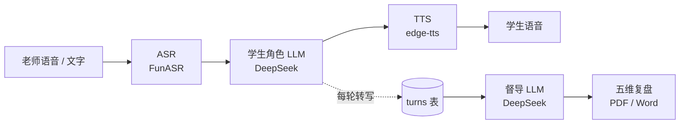

<div align="center">

# 谈心小辅 · 语音对练

**辅导员语音对练训练系统** —— 老师通过语音或文字，与一个「由 LLM 扮演的学生」对话，练习谈心与危机处置能力。


</div>

## 核心链路



### ✨ 已完成

| 能力 | 说明 |
|------|------|
| 🎙️ 实时语音全双工 | 火山豆包 Seeduplex，边说边听、插话即打断 |
| ✍️ 老师侧转写与打断采集 | 本地 FunASR 旁听麦克风切句，插话也收录 |
| 🗣️ 语音 / 文字双通道 | 回合制 `/ws/chat` + 真双工 `/ws/voice` |
| 📋 训练记录 | 按会话聚合，展示时间 / 轮数 / 得分 |
| 📊 五维复盘评价 | 三页翻页报告，督导 LLM 与学生 LLM 分离 |
| 📄 PDF / Word 导出 | Word 后端生成，PDF 浏览器打印 |

## 🏗️ 目录结构

```text
backend/                   FastAPI 服务端（编排 + 可插拔 Provider + 持久化）
  app/
    main.py                FastAPI 入口（CORS、挂载 REST 路由）
    config.py              读 .env 配置（pydantic-settings）
    db.py / models.py      异步 SQLite；turns / evaluations 表
    repo.py                转写、评价、会话列表的读写
    core/
      role.py              学生角色/隐藏事实 → system prompt（仅服务端）
      orchestrator.py      对话编排
      evaluator.py         复盘评分要点 + 转写组装
    providers/             ASR / LLM / TTS / Evaluator 接口与实现（换厂商=改配置）
      llm_deepseek.py      学生 LLM
      evaluator_deepseek.py 督导 LLM（评价，角色与评价分离）
      asr_funasr.py / tts_edge.py / *_stub.py
    export.py              复盘报告导出（Word .docx）
    routers/sessions.py    REST：训练记录 + 复盘 + 导出
    ws/chat.py             WebSocket 对话（文字/语音，回合制）
    ws/voice.py            WebSocket 实时语音（真双工，火山 Seeduplex）
  services/
    funasr_server.py       独立 FunASR 识别服务（自部署）
  requirements.txt
  .env.example             配置模板（复制为 .env 填密钥）
frontend/             原生 HTML 前端（无需构建）
  index.html               首页 / 场景选择（静态）
  conversation.html + voice.js   谈话训练（语音/文字，接后端）
  js/audio-capture.js 等         实时通话底层（收音 + 播放 + 打断，接 /ws/voice）
  records.html + records.js      训练记录列表（接 GET /sessions）
  review.html + review.js        复盘报告（接 GET/POST /sessions/{id}/review）
  details.html / import.html 等  案例详情 / 导入（UI 壳，待接 RAG）
  shared.js / styles.css    公共布局与样式
tools/
  caddy/Caddyfile          静态页面 + /ws/chat、/sessions 反向代理（监听 5180）
```

## 🧩 技术栈（可插拔）

| 环节 | 用的什么 | 说明 |
|------|----------|------|
| LLM（扮学生）| **DeepSeek** | OpenAI 兼容接口（`openai` SDK） |
| 评价 LLM（督导）| **DeepSeek**（独立 Provider）| 与扮学生的 LLM 分离，可单独换模型 |
| ASR（语音识别）| **FunASR**（阿里达摩院）| 自部署批式服务（8001 端口），模型 `paraformer-zh` + `fsmn-vad`，标点模型关闭（避免中文被拆成单字） |
| TTS（语音合成）| **edge-tts** | 微软 Edge 免费在线语音，输出 mp3，无需 GPU / 密钥 |
| 实时语音（全双工）| **火山豆包实时语音 3.0（Seeduplex）** | 仅配置 VOLC 密钥后可用 |
| 老师侧转写 / 打断 | 本地 FunASR + 本地 VAD | 旁听麦克风切句落库，与火山链路解耦 |
| 数据库 | **SQLite**（SQLAlchemy 2.0 异步 + aiosqlite）| 表：`turns`（对话）、`evaluations`（复盘）；改 `DATABASE_URL` 可切 PostgreSQL |
| 报告导出 | **python-docx**（Word）+ 浏览器打印（PDF）| Word 走 `/sessions/{id}/export.docx`，PDF 走前端打印 CSS |
| Web 框架 | **FastAPI** + WebSocket | REST + 两条 WS：`/ws/chat`、`/ws/voice` |
| 前端 | 原生 HTML / JS（无构建）| 不依赖 Vue / React |

> 💡 可插拔：`providers/` 下每个环节都是「接口 + 实现」，换厂商只改 `.env` 的 Provider 名，不动业务代码。密钥与隐藏事实都只在服务端。
>
> 🚧 未来升级：TTS 换 IndexTTS2（需 GPU + 情绪向量），ASR 可换讯飞/阿里云，LLM 可换 Claude——都只需新增一个 Provider 实现类。

## 🚀 快速开始

### ① 后端（FastAPI，端口 8000）

```bash
cd backend
python -m venv .venv
# Windows
.venv\Scripts\activate
# macOS/Linux
source .venv/bin/activate

pip install -r requirements.txt

cp .env.example .env        # 编辑 .env：填 DEEPSEEK_API_KEY
                            # ASR_PROVIDER=stub 可先跑纯文字；=funasr 走本地识别
                            # 可选：填 VOLC_APP_ID + VOLC_API_KEY 解锁「实时通话」

uvicorn app.main:app --port 8000
```

验证：浏览器打开 `http://127.0.0.1:8000/health` 应返回 `{"status":"ok"}`。

### ② FunASR 识别服务（端口 8001，语音输入需要）

```bash
cd backend
pip install funasr fastapi uvicorn
python services/funasr_server.py     # 首次自动下载 paraformer-zh 模型（约 1GB）
```

> ⚠️ **Python 版本**：主后端用 Python 3.11+；FunASR、IndexTTS2 需要 **Python 3.10–3.11**，请为它们单独建环境，不要和主后端混用。

### ③ 前端（原生 HTML，无需构建）

文字对练开箱即用；语音输入需先启动 FunASR（第 ② 步）。

- **本机测试**：双击 `frontend/index.html`（`voice.js` 会自动连本机后端 `ws://127.0.0.1:8000`）。
- **或用 Caddy**（静态页 + 反代，更接近真实部署）：

```bash
caddy run --config tools/caddy/Caddyfile
# 打开 http://localhost:5180/conversation.html
```

## 🔌 接口

### WebSocket `/ws/chat`

客户端 → 服务端（JSON）：

```json
{"type":"text","text":"老师说的话"}
{"type":"audio","audio_b64":"...","audio_format":"pcm16"}
{"type":"reset"}
```

服务端 → 客户端：

```json
{"type":"ready","session_id":"...","student_name":"小悦","scenario":"情绪困扰"}
{"type":"reply","text":"学生回复","emotion":null,"audio_b64":"...","audio_format":"mp3"}
```

### WebSocket `/ws/voice`（真双工实时语音，可选）

配好 `VOLC_APP_ID` + `VOLC_API_KEY` 后，谈话页点「实时通话」走此端点（密钥只在服务端）：

- 浏览器 → 服务端：二进制 PCM16 / 16kHz / 单声道（20ms 一帧），JSON 控制 `{"type":"cancel|mute|unmute|finish"}`
- 服务端 → 浏览器：`ready`（含 session_id）、二进制 pcm_s16le / 24kHz 学生语音、`event`（转写文本 / 状态）

转写与回合制共用 `turns` 表（`mode` 区分 pipeline/realtime）。老师侧不依赖火山——本地
FunASR 旁听同一路麦克风、按本地 VAD 切句转写落库；学生播报中老师插话（打断）触发
`cancel` → 采集窗口，把插话那半句也收进来。复盘照旧。

### REST

| 方法 | 路径 | 说明 |
|------|------|------|
| GET | `/health` | 健康检查 |
| GET | `/sessions` | 训练记录列表（时间/轮数/是否已复盘/得分）|
| GET | `/sessions/{id}/review` | 读取已生成的复盘 |
| POST | `/sessions/{id}/review` | 生成复盘（五维评分 + 证据 + 建议）|
| GET | `/sessions/{id}/export.docx` | 下载 Word 版复盘报告 |

复盘五维：共情引导、思想引领、问题解决、临场应变、语言表达，各 0–20，合计 100。

## 🛡️ 关键设计（对应需求文档）

- **服务端注入 / 私有角色设定**：学生「隐藏背景、表达特点、可控分支」在 `app/core/role.py` 组装成 system prompt，只在服务端，浏览器不可见。
- **角色与评价分离**：扮学生的 LLM 与打分的督导 LLM 是两个独立 Provider，可分别换模型；评价走独立 system prompt。
- **转写与评价持久化**：每轮对话写 `turns` 表（`mode` 区分 pipeline/realtime），复盘写 `evaluations` 表（session 唯一），供回听与证据评价。
- **实时老师侧转写与火山解耦**：火山 Seeduplex 双工下不吐可靠老师文字，改为本地 FunASR 旁听麦克风 + 本地 VAD 切句落库；火山链路完全不变、零影响，仅在未配 FunASR 时回退火山自带转写。
- **不依赖单一厂商**：`providers/` 下每个环节都是接口 + 实现，换厂商只改 `.env` 的 Provider 名。
- **模型密钥仅在服务端**：密钥、隐藏事实都在 `.env` / 服务端，前端只拿音频和文字。

## 🗺️ 后续路线

1. 场景选择 + 谈前准备 + 可控分支（当前角色/场景服务端硬编码为「小悦 / 情绪困扰」）
2. 回合制 VAD / 打断（实时模式已内置本地 VAD + 打断采集）
3. 真实案例库（RAG 检索）：导入页已有 UI，缺后端检索与知识库
4. TTS 升级 IndexTTS2（GPU，接 8 维情绪向量）
5. 危机专项（风险识别与转介）
